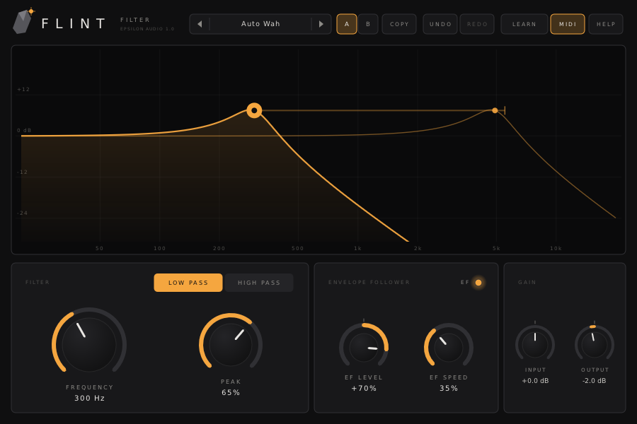

# Flint 1.0 — User Manual

Flint is a small, characterful filter. It has one 12 dB/oct low pass or high pass filter whose resonance (Peak) goes from warm and smooth to self‑oscillation. Its input stage saturates when you push it, and an envelope follower moves the cutoff with the loudness of the incoming sound. Flint runs as VST3, AU, CLAP and VST2 on macOS, Windows and Linux.

**Contents**

1. [Installing](#1-installing)
2. [A quick tour](#2-a-quick-tour)
3. [The filter](#3-the-filter)
4. [The display](#4-the-display)
5. [The envelope follower](#5-the-envelope-follower)
6. [Input, output and saturation](#6-input-output-and-saturation)
7. [Knobs](#7-knobs)
8. [A/B, undo and redo](#8-ab-undo-and-redo)
9. [MIDI Learn](#9-midi-learn)
10. [Presets](#10-presets)
11. [Help and hover tips](#11-help-and-hover-tips)
12. [Recipes](#12-recipes)
13. [Keyboard and mouse reference](#13-keyboard-and-mouse-reference)
14. [Parameter reference](#14-parameter-reference)
15. [Troubleshooting](#15-troubleshooting)

---

## 1. Installing

Download the zip for your system from the project's **Releases** page and copy the plugin files:

| System | Copy | To |
|---|---|---|
| macOS | `Flint.vst3`, `Flint.component` (AU), `Flint.clap` | `~/Library/Audio/Plug-Ins/VST3`, `.../Components`, `.../CLAP` |
| Windows | the `Flint.vst3` folder, `Flint.clap` | `C:\Program Files\Common Files\VST3\`, `...\CLAP\` |
| Linux | `Flint.vst3`, `Flint.clap` | `~/.vst3/`, `~/.clap/` |

**macOS:** the builds are signed ad hoc but not notarized, so macOS may block them the first time. Open Terminal and run:

```
xattr -dr com.apple.quarantine ~/Library/Audio/Plug-Ins/*/Flint*
```

Rescan plugins in your DAW. Flint appears under **Epsilon Audio** as a filter effect.

---

## 2. A quick tour



- **Header:** preset browser, A/B and COPY, UNDO/REDO, LEARN (MIDI Learn), MIDI on/off and HELP.
- **Display:** the filter's frequency response. Drag the dot to change frequency and peak. When the envelope follower is on, a second, fainter curve shows where it has moved the filter right now.
- **Filter panel:** RESPONSE (low pass or high pass), FREQUENCY and PEAK.
- **Envelope follower panel:** EF LEVEL, EF SPEED and the EF light.
- **Gain panel:** INPUT and OUTPUT.

To start, put Flint on a drum loop or a bass line, choose the **Auto Wah** preset and play. Then drag the dot around.

---

## 3. The filter

Flint has one resonant state‑variable filter with a 12 dB per octave slope. It is the gentle, musical slope of many classic synthesizer filters.

- **FREQUENCY** sets the cutoff, from 20 Hz to 20 kHz.
- **PEAK** adds resonance at the cutoff:
  - Up to about 50% it shapes the tone gently.
  - From 60% to 90% it gives the familiar squelchy, vocal sweep.
  - Above about 95% the filter starts to ring on by itself.
  - At 100% it self‑oscillates: it produces a sine‑like tone at the cutoff frequency, even when no audio comes in. You can play this tone by sweeping or automating the frequency.
- **RESPONSE**:
  - **LOW PASS** keeps what is below the cutoff, so the sound gets darker.
  - **HIGH PASS** keeps what is above it, so the sound gets thinner.

  Switching between the two crossfades smoothly, so it is safe while playing.

All controls are smoothed, so moving or automating them never clicks or zippers.

---

## 4. The display

The display shows the filter's response from 20 Hz to 20 kHz, with the level from −30 to +24 dB.

- **The dot** sits on the curve at the cutoff frequency.
  - Drag it left and right to change the frequency.
  - Drag it up and down to change the peak.
  - Hold **Shift** while dragging for fine control.
- **Click anywhere** in the display to move the cutoff to that frequency. You can keep dragging from there.
- **The mouse wheel** over the display changes the peak.
- **The envelope follower's reach:** when EF Level is not zero, a horizontal bar runs from the dot to the furthest point the follower can take the cutoff. A small marker on the bar and the faint second curve show where the filter is right now. Orange means the follower is opening the filter (moving it up), blue means it is closing it.

---

## 5. The envelope follower

The envelope follower listens to the incoming audio and moves the cutoff according to how loud it is.

- **EF LEVEL** sets the depth and direction:
  - Right of centre, louder sound **opens** the filter. This is the classic auto‑wah or envelope‑filter "quack".
  - Left of centre, louder sound **closes** the filter. This darkens loud passages and ducks the highs.
  - At full level the follower can move the cutoff by up to **six octaves**.
  - At centre the follower is off. Ctrl/Cmd‑click resets it to centre.
- **EF SPEED** sets how quickly the movement follows the sound:
  - Fully left, it reacts in well under a millisecond and lets go within about 10 ms, so it follows every transient.
  - Fully right, it takes about 60 ms to rise and 0.6 s to fall back, so it follows the overall level.
  - The centre is a good starting point for most material.
- **The EF light** glows as the follower moves the filter: brighter means more movement, orange is upward, blue is downward.

The follower responds to levels from about −54 dBFS up to 0 dBFS. It measures the incoming signal **before** the Input gain, so changing Input changes the drive but not the envelope.

---

## 6. Input, output and saturation

Flint's input stage saturates smoothly, and the resonance is shaped so the filter stays musical when pushed.

- **INPUT** (−24 to +24 dB) sets how hard the signal hits the filter:
  - At 0 dB and below, Flint is clean and creamy.
  - Turning it up adds warmth, then grit and clipping.
  - High peak settings get rougher and more aggressive when driven.
- **OUTPUT** (−24 to +24 dB) sets the level after the filter. Turn it down by roughly as much as you raised Input, and to make up for loud resonance. Then A/B comparisons and bypassing happen at equal loudness.

Flint softly limits its output just below 0 dBFS, so even a screaming, self‑oscillating filter will not exceed full scale.

---

## 7. Knobs

- **Drag** the middle of a knob up or down. Hold **Shift** for fine adjustment.
- **Grab the rim** to turn the knob in a circle with the mouse.
- **Mouse wheel** over a knob turns it. Hold **Shift** for small steps.
- **Double‑click** a knob to type a value. Frequencies accept `1.5k` or `1500`, gains accept `-6`, and percentages accept `40`. Press Enter to apply or Esc to cancel.
- **Ctrl‑click** (Cmd‑click on macOS) resets a knob to its default.

EF Level, Input and Output are bipolar: their ring lights up from the centre outwards.

---

## 8. A/B, undo and redo

- **A / B:** Flint holds two complete settings.
  - Click **B** to switch to the second one. The first time, B starts as a copy of A.
  - Click **A** to go back.
- **COPY** copies the current setting into the other slot.
- **UNDO / REDO** step through your edits. Every gesture is one step, including:
  - moving a knob or the dot
  - switching response
  - loading a preset
  - switching between A and B

  Shortcuts: Cmd/Ctrl‑Z to undo, and Cmd/Ctrl‑Shift‑Z or Cmd/Ctrl‑Y to redo.

---

## 9. MIDI Learn

1. Click **LEARN**. The header button reads LEARNING.
2. Click a control. A small "?" badge appears on it.
3. Move a knob or fader on your MIDI controller. The badge changes to show the CC number.
4. Repeat for other controls, then click **LEARN** again (or press Esc) to finish.

While learning:

- Right‑click a control to unassign it.
- **CLEAR ALL ASSIGNMENTS** removes every assignment.

Assignments are saved with your project. The **MIDI** button in the header switches MIDI control on and off without forgetting the assignments.

---

## 10. Presets

Click the preset name to open the browser. It lists the factory presets in four groups and your own presets in a fifth column:

| Group | Presets |
|---|---|
| Tone | Warm, Muffled, Thin, Clear the Low End, Telephone, Creamy |
| Envelope | Auto Wah, Funk Quack, Duck Dark, Slow Bloom, Snap Open, High Pass Breath, Drum Skin |
| Resonant | Squelch, Whistle, Singing, Acid Line, Ringing |
| Drive | Crunch, Fuzz Box, Hot Tape, Angry High Pass, Broken |

- The arrows next to the name, and the mouse wheel over it, step through all presets in order.
- A **\*** after the name means you have changed the preset.
- **SAVE CURRENT AS…** saves your own preset as a small text file, in one of these folders:
  - macOS: `~/Library/Audio/Presets/Epsilon Audio/Flint`
  - Windows: `%APPDATA%\Epsilon Audio\Flint\Presets`
  - Linux: `~/.config/epsilon-audio/flint/presets`
- To delete one of your presets, right‑click it in the browser and click again to confirm.

**Search and favourites.** With the browser open, just type to narrow the list to presets whose name or category matches; Backspace edits, Esc clears the search and then closes the browser. Click the star at the right of a preset to add it to the FAVOURITES column, and again to remove it. Favourites are kept in `favourites.txt` in your presets folder.

---

## 11. Help and hover tips

- Rest the pointer on any control, header button, the display dot or the EF light. After a moment a tip explains what it does and shows its current value and any MIDI assignment.
- **HELP** opens the in‑plugin help pages.
- The switch at the bottom of the help window turns hover tips on or off.
- **FULL MANUAL (WEB)** opens this manual.

---

## 12. Recipes

- **Funky guitar or clav:** Auto Wah or Funk Quack. Set EF Level so the loudest notes open the filter fully, and use Speed to set how "quacky" it is.
- **Bass line that talks:** low pass at 250–400 Hz, Peak 70–80%, EF Level +60%, Speed 20–30%.
- **Drum bus character:** Drum Skin, or low pass at 6–8 kHz with Input +6 dB and Output −4 dB to round off the transients.
- **Darken the loud parts:** Duck Dark, with EF Level to the left of centre.
- **Thin a pad out of the way:** high pass at 300–600 Hz with a touch of Peak, so it sits above the bass and kick.
- **Sine tone or sweep effect:** Singing (Peak 100%), then automate the frequency.
- **Lo‑fi grit:** Crunch or Fuzz Box. Balance Input against Output.

---

## 13. Keyboard and mouse reference

| Action | How |
|---|---|
| Change frequency and peak | Drag the dot in the display |
| Move the cutoff | Click anywhere in the display |
| Change peak | Mouse wheel over the display |
| Fine adjustment | Shift‑drag (knobs and the dot), Shift‑wheel |
| Type a value | Double‑click a knob |
| Reset a knob | Ctrl/Cmd‑click |
| Undo / redo | Ctrl/Cmd‑Z / Ctrl/Cmd‑Shift‑Z or Ctrl/Cmd‑Y |
| Step presets | Arrows or mouse wheel on the preset name |
| Unassign MIDI (in Learn) | Right‑click a control |
| Close help, finish Learn, cancel typing | Esc |

---

## 14. Parameter reference

New parameters are only ever added at the end, so sessions and automation keep working across versions.

| # | Name | Range | Default |
|---|---|---|---|
| 0 | Frequency | 20 Hz – 20 kHz (log) | 1 kHz |
| 1 | Peak | 0 – 100% | 30% |
| 2 | Response | Low Pass / High Pass | Low Pass |
| 3 | EF Level | −100% – +100% (±6 octaves) | 0 (off) |
| 4 | EF Speed | 0 – 100% (fast – slow) | 50% |
| 5 | Input Gain | −24 – +24 dB | 0 dB |
| 6 | Output Gain | −24 – +24 dB | 0 dB |
| 7 | MIDI | Off / On | On |
| 8 | EF Modulation (output) | −6 – +6 octaves | — |
| 9 | MIDI Learn (output) | internal | — |

---

## 15. Troubleshooting

- **Flint doesn't appear in my DAW.** Check the install folders above and rescan plugins. On macOS, run the `xattr` command from section 1.
- **A whistle or tone with no input.** Peak is at or near 100%, so the filter is self‑oscillating. Lower Peak below about 95%.
- **The envelope follower does nothing.** Check that EF Level is away from centre and that the incoming level is above about −50 dBFS. The EF light shows whether it is moving.
- **Louder than bypass.** Lower Output, especially with Input gain or high Peak.
- **A MIDI controller doesn't respond.** Check that the MIDI button is lit and that your DAW sends MIDI to the plugin's track.
